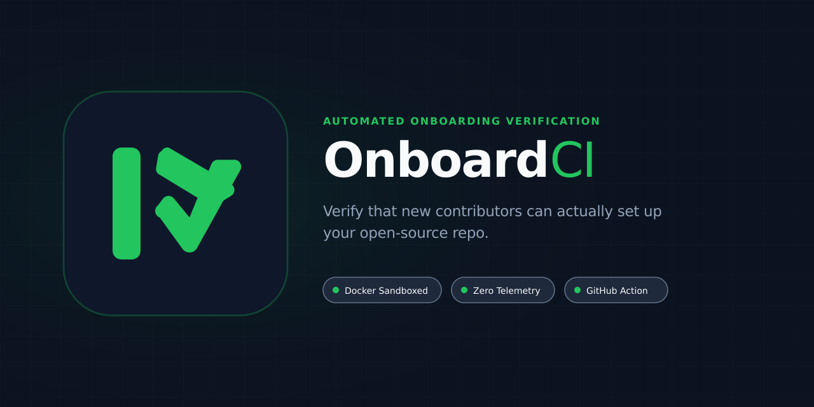

<p align="center">
  
</p>

<h1 align="center">OnboardCI</h1>

<p align="center">
  <strong>Verify that new contributors can actually set up your repository by following only your docs.</strong>
</p>

<p align="center">
  <a href="https://github.com/Zerxen-dev/onboardci/actions"></a>
  <a href="LICENSE"></a>
  <a href="assets/brand.md"></a>
  
</p>

---

## What is OnboardCI?

Most open-source onboarding guides rot over time: an unmentioned environment variable is required, a prerequisite CLI is omitted, or a database seed step goes undocumented. Established maintainers rarely notice because their local dev environments are already configured.

**OnboardCI** is a single-binary CLI tool and GitHub Action that verifies repository setup from the perspective of a brand new contributor:
1. Parses `README.md`, `CONTRIBUTING.md`, or `.onboardci.yml`.
2. Extracts documented setup and test commands with exact line provenance.
3. Executes them sequentially inside a fresh, isolated Docker container (non-root, timeout-enforced, with no host bind mounts).
4. Produces actionable failure diagnostics pointing to the exact documentation line and missing requirement.

---

## Installation

### Via Go

```bash
go install github.com/Zerxen-dev/onboardci/cmd/onboardci@latest
```

### Pre-built Binaries

Download pre-compiled binaries for Linux, macOS, and Windows from the [GitHub Releases](https://github.com/Zerxen-dev/onboardci/releases) page.

---

## Quickstart

### 1. Dry Run (Default)

Inspect what commands OnboardCI extracts from your documentation without running anything:

```bash
onboardci check
```

Output:
```text
OnboardCI — Dry Run (Listing Extracted Commands)

[1] setup (README.md line 34):
    npm install
[2] test (README.md line 42):
    npm test

Total: 2 commands extracted.
Run with '--execute' to verify them inside a clean Docker sandbox.
```

### 2. Sandbox Verification Execution

Execute the extracted commands in an isolated Docker container:

```bash
onboardci check --execute
```

When onboarding fails (e.g. missing environment variable), OnboardCI reports the exact documentation line and diagnosis:

```text
FAIL: README.md line 42
Command: npm test
Reason: missing env var DATABASE_URL
Suggestion: document required env vars or provide .env.example
```

### 3. Machine-Readable JSON Output

Emit structured JSON for CI scripts and tooling:

```bash
onboardci check --json
```

---

## Configuration (`.onboardci.yml`)

While OnboardCI automatically detects setup and test blocks from Markdown files, you can explicitly configure commands and container constraints with `.onboardci.yml`:

```yaml
# Setup commands executed in order
setup:
  - npm ci
  - npm run build

# Verification/test commands
test:
  - npm test

# Default environment variables injected into container
env:
  - DATABASE_URL=sqlite://test.db
  - NODE_ENV=test

# Container runtime constraints
docker:
  image: node:20-alpine
  timeout: 10m
  user: "1000:1000"
  cpus: "2.0"
  memory: "2g"
```

---

## GitHub Action Integration

Verify onboarding documentation on every Pull Request using `action.yml`:

```yaml
name: OnboardCI Check

on:
  pull_request:
    branches: [main]

jobs:
  verify-onboarding:
    runs-on: ubuntu-latest
    steps:
      - uses: actions/checkout@v4

      - name: Verify Docs in Clean Container
        uses: Zerxen-dev/onboardci@v0.1.0
        with:
          execute: 'true'
          github-token: ${{ secrets.GITHUB_TOKEN }}
```

When documentation breaks or setup instructions drift, OnboardCI posts a diagnostic comment directly to the pull request with line references and suggestions.

---

## CLI Command Surface

```text
Usage:
  onboardci [command]

Available Commands:
  check       Extract and verify onboarding commands from docs or .onboardci.yml
  version     Print the version number of OnboardCI

Global Flags:
      --config string    Path to .onboardci.yml config file
      --cwd string       Target repository directory (default ".")
      --timeout string   Execution timeout (e.g. 10m, 300s) (default "10m")

Check Flags:
      --execute          Execute extracted commands inside Docker sandbox
      --json             Output machine-readable JSON format
```

---

## Non-Goals

To maintain a zero-bloat developer tool, OnboardCI explicitly avoids:
- **CI Orchestration**: Not an alternative to GitHub Actions or GitLab CI matrix pipelines.
- **Security & Vulnerability Scanning**: Not a SAST tool, SCA scanner, or CVE auditor.
- **Telemetry & Cloud Services**: Zero analytics, zero phone-home calls, zero accounts or subscriptions.

Read more in [docs/non-goals.md](docs/non-goals.md).

---

## Brand Identity

The official visual identity, geometry, palette hex codes, and usage rules are detailed in [assets/brand.md](assets/brand.md).

| Asset | Preview | Formats | Dimensions |
|---|---|---|---|
| **Primary Mark** |  | [SVG](assets/logo.svg) • [PNG](assets/logo.png) • [1024px PNG](assets/logo-1024.png) | 512 × 512 px / 1024 × 1024 px |
| **Wordmark** |  | [SVG](assets/logo-wordmark.svg) • [PNG](assets/logo-wordmark.png) | 960 × 240 px |
| **Monochrome Mark** |  | [SVG](assets/logo-mono.svg) • [PNG](assets/logo-mono.png) | 512 × 512 px |
| **Favicon** |  | [SVG](assets/favicon.svg) • [PNG](assets/favicon.png) • [64px](assets/favicon-64.png) | 32 × 32 px / 64 × 64 px |
| **Social Preview** |  | [SVG](assets/social-preview.svg) • [PNG](assets/social-preview.png) | 1280 × 640 px |

---

## Contributing

We welcome contributions! Please review [CONTRIBUTING.md](CONTRIBUTING.md) for local development setup, how to add language heuristics, run tests, and propose brand updates.

---

## License

OnboardCI is licensed under the [Apache License, Version 2.0](LICENSE).
